# Lab 11. 정리: 비용이 새지 않게 모두 삭제하기

| 소요 시간 | 예상 비용 | Terraform 스택 | 선행 실습 |
|---|---|---|---|
| 20–40분 | 정리하지 않으면 계속 과금 | 모든 스택 (역순) | 실습을 마친 모든 Lab |

> [!CAUTION]
> AKS 노드(VM), NAT Gateway, 공인 IP, Premium ACR, Managed Grafana, Defender 플랜은 **켜 두는 동안 계속 과금**됩니다. 실습을 마쳤거나 오래 쉴 때는 반드시 정리하세요.

## 가장 쉬운 방법: 정리 스크립트

생성의 역순 삭제 · 리소스 잠금 해제 · 이미 지운 스택 건너뛰기 · 삭제 후 남은 리소스 점검까지 `scripts/cleanup.sh` 가 한 번에 처리합니다. **먼저 `--dry-run` 으로 무엇을 지울지 확인**하세요(아무것도 지우지 않습니다).

```bash
# 저장소 루트에서, apply 때와 같은 환경 변수(ARM_SUBSCRIPTION_ID, TF_VAR_allowed_ip_ranges)가 설정된 터미널에서 실행
scripts/cleanup.sh --dry-run                 # 1) 계획만 출력
scripts/cleanup.sh                           # 2) 'delete' 를 입력하면 03~10 스택 삭제
scripts/cleanup.sh --yes 05-aks 04-platform  # (선택) 일부 스택만, 질문 없이
scripts/cleanup.sh --include-bootstrap       # (선택) 02-bootstrap(state 저장소)까지 — 아래 2단계를 먼저 읽으세요
```

| 안전장치 | 동작 |
|---|---|
| 확인 입력 | `--yes` 가 없으면 `delete` 를 입력해야 시작합니다. 입력이 없으면(파이프/CI) 취소됩니다. |
| 구독 확인 | `ARM_SUBSCRIPTION_ID` 와 `az` 의 현재 구독이 다르면 시작하지 않습니다. |
| 순서 | 스택을 어떤 순서로 입력해도 항상 안전한 삭제 순서(06/07 → 05 → 04 → 03)로 정렬합니다. |
| 재실행 | 이미 지운 스택(빈 state)은 건너뜁니다. 중간에 실패해도 원인을 해결하고 같은 명령을 다시 실행하면 됩니다. |
| 클러스터가 먼저 사라진 경우 | 06/07 의 쿠버네티스 리소스는 state 에서만 제거하고 Azure 리소스를 삭제합니다. |
| 02-bootstrap | state 가 아직 원격에 있으면 지우지 않고 로컬로 되돌리는 방법을 안내합니다. |

<!-- tf:include path="scripts/cleanup.sh" -->
```bash title="scripts/cleanup.sh"
#!/usr/bin/env bash
# 실습 리소스를 "생성의 역순"으로 삭제합니다 (Lab 11 의 절차를 자동화).
#   10-aks-automatic → 08-governance → 07-ingress → 06-workload → 05-aks → 04-platform → 03-network   (+ 02-bootstrap 은 옵션)
#   06/07 은 클러스터가 살아 있어야 kubernetes provider 가 접속해 지울 수 있으므로 05 보다 먼저 지웁니다.
#
# 사용법:
#   scripts/cleanup.sh --dry-run                 # 아무것도 지우지 않고 할 일만 출력 (먼저 이것부터!)
#   scripts/cleanup.sh                           # 'delete' 를 입력해 확인한 뒤 03~10 스택 삭제
#   scripts/cleanup.sh --yes 05-aks 04-platform  # 지정한 스택만, 질문 없이
#   scripts/cleanup.sh --include-bootstrap       # 02-bootstrap(state 저장소)까지 삭제 (로컬 state 로 되돌린 경우만)
#
# 필요: terraform, az(로그인), terraform/backend.hcl, 환경 변수 ARM_SUBSCRIPTION_ID · TF_VAR_allowed_ip_ranges (apply 때와 같은 값)
# 이미 지운 스택은 건너뛰므로, 중간에 실패해도 원인을 해결한 뒤 같은 명령을 다시 실행하면 됩니다.
set -uo pipefail

HERE="$(cd "$(dirname "${BASH_SOURCE[0]}")" && pwd)"
# shellcheck source=lib/common.sh
source "${HERE}/lib/common.sh"
cd "$ROOT" || exit 2

STACK_ORDER="10-aks-automatic 08-governance 07-ingress 06-workload 05-aks 04-platform 03-network" # 삭제 순서
yes=0
dry=0
bootstrap=0
requested=""

while [ "$#" -gt 0 ]; do
  case "$1" in
    -y | --yes) yes=1 ;;
    -n | --dry-run) dry=1 ;;
    --include-bootstrap) bootstrap=1 ;;
    -h | --help)
      sed -n '2,13p' "${BASH_SOURCE[0]}" | sed 's/^# \{0,1\}//'
      exit 0
      ;;
    -*)
      echo "알 수 없는 옵션: $1 (--help 참고)" >&2
      exit 2
      ;;
    *) requested="$requested $1" ;;
  esac
  shift
done

for r in $requested; do
  case " $STACK_ORDER " in
    *" $r "*) ;;
    *)
      echo "알 수 없는 스택: $r (사용 가능: $STACK_ORDER)" >&2
      exit 2
      ;;
  esac
done

# 지정한 스택을 항상 "삭제 순서"대로 정렬합니다 (순서를 바꿔 입력해도 안전).
targets=""
for s in $STACK_ORDER; do
  if [ -z "$requested" ] || printf ' %s ' "$requested" | grep -q " $s "; then targets="$targets $s"; fi
done
[ "$bootstrap" -eq 1 ] && targets="$targets 02-bootstrap"

# --- 실행 도우미 ---------------------------------------------------------------
# run 명령... : 명령을 보여 주고 실행합니다 (dry-run 이면 보여 주기만).
run() {
  printf '  %s$ %s%s\n' "$C_DIM" "$*" "$C_OFF"
  [ "$dry" -eq 1 ] || "$@"
}

# run_quiet 명령... : 출력은 숨기고, 실패했을 때만 출력을 보여 줍니다 (init 처럼 시끄러운 명령용).
run_quiet() {
  local out
  printf '  %s$ %s%s\n' "$C_DIM" "$*" "$C_OFF"
  [ "$dry" -eq 1 ] && return 0
  out="$("$@" 2>&1)" || {
    printf '%s\n' "$out"
    return 1
  }
}

tf_init() { run_quiet terraform -chdir="terraform/$1" init -backend-config=../backend.hcl -input=false -no-color; }
tf_state() { terraform -chdir="terraform/$1" state list 2>/dev/null; }

# 05-aks state 에 클러스터가 없으면(= 이미 지움) 0
cluster_gone() {
  [ "$dry" -eq 1 ] && return 1
  tf_init 05-aks >/dev/null 2>&1 || return 1
  ! tf_state 05-aks | grep -q '^azurerm_kubernetes_cluster\.this$'
}

# 클러스터가 이미 없으면 kubernetes provider 가 접속할 수 없으므로, 안에 있던 리소스는 state 에서만 제거합니다.
drop_k8s_state_if_cluster_gone() {
  local res
  cluster_gone || return 0
  warn "$1: 클러스터가 이미 없습니다 → 쿠버네티스 리소스를 state 에서 제거한 뒤 Azure 리소스만 삭제합니다"
  # 파일 디스크립터 3 으로 목록을 읽어, terraform 이 표준 입력을 가져가지 못하게 합니다.
  while IFS= read -r res <&3; do
    run terraform -chdir="terraform/$1" state rm "$res"
  done 3< <(tf_state "$1" | grep -E '^kubernetes_')
}

# 08 이 건 리소스 잠금(CanNotDelete)이 있으면 destroy 가 ScopeLocked 로 실패하므로 먼저 해제합니다.
unlock_resource_locks() {
  section "리소스 잠금 해제 (08-governance)"
  if ! tf_init 08-governance; then
    warn "08-governance 를 초기화하지 못해 잠금 확인을 건너뜁니다"
    return 0
  fi
  if [ "$dry" -eq 1 ]; then
    info "(잠금이 있을 때만 실행됩니다)"
    run terraform -chdir=terraform/08-governance apply -auto-approve -input=false -no-color -var enable_resource_locks=false
  elif tf_state 08-governance | grep -q '^azurerm_management_lock\.'; then
    run terraform -chdir=terraform/08-governance apply -auto-approve -input=false -no-color -var enable_resource_locks=false || return 1
  else
    skip "해제할 잠금이 없습니다"
  fi
}

destroy_stack() {
  local s="$1"
  section "destroy $s"
  if [ ! -d "terraform/$s" ]; then
    skip "스택 디렉터리가 없습니다"
    return 0
  fi
  tf_init "$s" || {
    fail "$s: init 실패 (terraform/backend.hcl 과 ARM_SUBSCRIPTION_ID 를 확인하세요)"
    return 1
  }
  if [ "$dry" -eq 0 ] && [ -z "$(tf_state "$s")" ]; then
    skip "$s: state 가 비어 있습니다 (이미 삭제됨)"
    return 0
  fi
  case "$s" in 06-workload | 07-ingress) drop_k8s_state_if_cluster_gone "$s" ;; esac
  if run terraform -chdir="terraform/$s" destroy -auto-approve -input=false -lock-timeout=300s -no-color; then
    if [ "$dry" -eq 1 ]; then info "(dry-run) 실제로 실행하면 $s 가 삭제됩니다"; else pass "$s 삭제 완료"; fi
  else
    fail "$s: destroy 실패 → 위 오류를 해결한 뒤 같은 명령을 다시 실행하세요 (이미 지운 스택은 건너뜁니다)"
    return 1
  fi
}

# 02-bootstrap 은 state 가 담긴 저장소 자체이므로, 로컬 state 로 되돌린 경우에만 지웁니다.
destroy_bootstrap() {
  section "destroy 02-bootstrap (state 저장소)"
  if grep -Eq '^[[:space:]]*backend "azurerm"' terraform/02-bootstrap/versions.tf; then
    fail "02-bootstrap 의 state 가 아직 원격(Blob)에 있습니다. 자기 자신이 담긴 저장소는 지울 수 없으므로 먼저 로컬로 되돌리세요:"
    info "1) terraform/02-bootstrap/versions.tf 의 backend \"azurerm\" 블록을 다시 주석 처리"
    info "2) terraform -chdir=terraform/02-bootstrap init -migrate-state -force-copy"
    info "3) 이 스크립트를 --include-bootstrap 으로 다시 실행"
    return 1
  fi
  run_quiet terraform -chdir=terraform/02-bootstrap init -input=false -no-color || return 1
  if run terraform -chdir=terraform/02-bootstrap destroy -auto-approve -input=false -no-color; then
    run rm -f terraform/backend.hcl
    if [ "$dry" -eq 1 ]; then info "(dry-run) 실제로 실행하면 02-bootstrap 이 삭제됩니다"; else pass "02-bootstrap 삭제 완료"; fi
  else
    fail "02-bootstrap: destroy 실패"
    return 1
  fi
}

report_leftovers() {
  local rgs nodes kvs
  section "정리 확인"
  rgs="$(az group list --query "[?tags.lab=='aks-terraform-guide'].name" -o tsv 2>/dev/null)"
  nodes="$(az group list --query "[?contains(name,'-aks-nodes') || (starts_with(name,'MC_') && contains(name,'-automatic_'))].name" -o tsv 2>/dev/null)"
  kvs="$(az keyvault list-deleted --query '[].name' -o tsv 2>/dev/null)"
  if [ -z "$rgs" ]; then
    pass "태그 lab=aks-terraform-guide 리소스 그룹이 없습니다"
  else
    warn "남아 있는 리소스 그룹: $(printf '%s' "$rgs" | tr '\n' ' ')"
    info "그래도 지워지지 않으면(Terraform 을 다시 쓸 계획이 없을 때만): az group delete -n <이름> --yes --no-wait"
  fi
  [ -z "$nodes" ] || warn "AKS 노드 리소스 그룹이 남아 있습니다: $(printf '%s' "$nodes" | tr '\n' ' ') (클러스터 삭제 후 몇 분 뒤 사라집니다)"
  info "soft-delete 상태의 Key Vault: ${kvs:-없음} (purge protection 이면 7일간 이름만 점유하며 비용은 없습니다)"
}

# --- 시작 -----------------------------------------------------------------------
section "삭제 계획"
if command -v az >/dev/null 2>&1 && az account show >/dev/null 2>&1; then
  info "구독: $(az account show --query "join(' ', [name, id])" -o tsv 2>/dev/null)"
fi
for s in $targets; do info "- $s"; done
[ "$dry" -eq 1 ] && info "dry-run: 실제로는 아무것도 삭제하지 않습니다."

if [ "$dry" -eq 0 ]; then
  require_cmd terraform az || exit 2
  az account show >/dev/null 2>&1 || {
    echo "az login 이 필요합니다." >&2
    exit 2
  }
  [ -n "${ARM_SUBSCRIPTION_ID:-}" ] || {
    echo "ARM_SUBSCRIPTION_ID 가 설정되어 있지 않습니다 (Lab 01)." >&2
    exit 2
  }
  [ "$ARM_SUBSCRIPTION_ID" = "$(az account show --query id -o tsv)" ] || {
    echo "ARM_SUBSCRIPTION_ID 와 az 의 현재 구독이 다릅니다. 지울 구독을 확인하세요." >&2
    exit 2
  }
  [ -n "${TF_VAR_allowed_ip_ranges:-}" ] || {
    echo "TF_VAR_allowed_ip_ranges 가 설정되어 있지 않습니다 (apply 때와 같은 값)." >&2
    exit 2
  }
  [ -f terraform/backend.hcl ] || {
    echo "terraform/backend.hcl 이 없습니다 (Lab 02 에서 만든 파일)." >&2
    exit 2
  }
  if [ "$yes" -eq 0 ]; then
    printf '\n위 스택의 리소스가 모두 삭제됩니다. 계속하려면 %sdelete%s 를 입력하세요: ' "$C_BLD" "$C_OFF"
    read -r answer
    [ "$answer" = "delete" ] || {
      echo "취소했습니다."
      exit 1
    }
  fi
fi

case " $targets " in
  *" 08-governance "* | *" 04-platform "* | *" 03-network "*) unlock_resource_locks || fail "잠금 해제 실패" ;;
esac

for s in $targets; do
  if [ "$s" = "02-bootstrap" ]; then destroy_bootstrap || break; else destroy_stack "$s" || break; fi
done

if [ "$dry" -eq 1 ]; then
  printf '\n%sdry-run 이 끝났습니다. 실제로 삭제하려면 --dry-run 없이 다시 실행하세요.%s\n' "$C_BLD" "$C_OFF"
  [ "$FAIL" -eq 0 ]
  exit
fi

report_leftovers
summary
```
<!-- /tf:include -->

> [!NOTE]
> 아래 *삭제 순서* 부터 *정리 확인* 까지는 이 스크립트가 하는 일을 **수동으로** 풀어 쓴 것입니다. 스크립트 없이 직접 진행하거나, 어디서 실패했는지 이해할 때 참고하세요.

## 삭제 순서 (생성의 역순)



`06/07` 은 클러스터가 살아 있어야 `kubernetes` provider 가 접속해 삭제할 수 있으므로 **05 보다 먼저** 지웁니다.

```text
10-aks-automatic → 08-governance → 07-ingress → 06-workload → 05-aks → 04-platform → 03-network → 02-bootstrap
```

## 사전 점검 (잠금과 구독 단위 설정)

```bash
cd terraform

# 1) 08 에서 잠금을 켰다면 먼저 해제 (잠금이 있으면 destroy 가 ScopeLocked 로 실패)
terraform -chdir=08-governance apply -auto-approve -var enable_resource_locks=false

# 2) Defender 구독 플랜을 켰다면 08 destroy 로 함께 꺼집니다. (Terraform 밖에서 켰다면 직접 끄기)
az security pricing show -n Containers --query pricingTier -o tsv
# az security pricing create -n Containers --tier free
```

## 1단계. 스택별 destroy

```bash
for s in 10-aks-automatic 08-governance 07-ingress 06-workload 05-aks 04-platform 03-network; do
  echo "================ destroy $s"
  terraform -chdir=$s init -backend-config=../backend.hcl -input=false >/dev/null
  terraform -chdir=$s destroy -auto-approve
done
```

> [!NOTE]
> 환경 변수(`ARM_SUBSCRIPTION_ID`, `TF_VAR_allowed_ip_ranges` 등)가 설정된 터미널에서 실행하세요. `10-aks-automatic` 을 만든 적이 없다면 `destroy` 가 "No changes" 로 끝납니다.
> 각 스택의 `destroy` 는 `terraform plan -destroy` 로 먼저 삭제 목록을 확인하는 습관을 들이세요.

### 클러스터를 먼저 지워서 06/07 destroy 가 실패할 때

`kubernetes` provider 가 접속할 클러스터가 없으면 `destroy` 가 실패합니다. 이 경우 쿠버네티스 리소스를 state 에서 제거한 뒤 Azure 리소스만 삭제합니다(클러스터가 사라졌으므로 안의 리소스도 이미 없습니다).

```bash
cd 07-ingress
terraform state list | grep -E '^kubernetes_' | xargs -n1 terraform state rm
terraform destroy -auto-approve
```

## 2단계. 부트스트랩(state 저장소) 삭제

`02-bootstrap` 의 state 를 Blob 으로 이전했다면, **자기 자신이 담긴 스토리지를 지울 수 없습니다.** 먼저 로컬 state 로 되돌린 뒤 삭제합니다.

```bash
cd 02-bootstrap
# versions.tf 의 backend "azurerm" 블록을 다시 주석 처리한 뒤
terraform init -migrate-state -force-copy
terraform destroy -auto-approve
rm -f ../backend.hcl
```

## 3단계. 정리 확인

```bash
# 이 가이드가 만든 리소스 그룹 (태그 lab=aks-terraform-guide) → 비어 있어야 합니다
az group list --query "[?tags.lab=='aks-terraform-guide'].name" -o tsv

# AKS 가 만든 노드 리소스 그룹(이 가이드의 이름 규칙)도 사라졌는지
az group list --query "[?contains(name,'-aks-nodes') || (starts_with(name,'MC_') && contains(name,'-automatic_'))].name" -o tsv

# soft-delete 상태로 남은 리소스
az keyvault list-deleted --query "[].{name:name, purgeDate:properties.scheduledPurgeDate}" -o table
az monitor log-analytics workspace list-deleted-workspaces -o table 2>/dev/null

# 고아가 된 역할 할당(삭제된 주체) 정리가 필요하다면
az role assignment list --all --query "[?principalName==''].{id:id, scope:scope}" -o table
```

### Key Vault 가 남아 있는 이유

Lab 04 의 Key Vault 는 `purge_protection_enabled = true`(권장)이므로 삭제 후에도 **soft-deleted 상태로 7일간 이름을 점유**합니다. 같은 이름으로 다시 만들면 provider 가 자동 복구(`recover_soft_deleted_key_vaults = true`)합니다. 비용은 발생하지 않습니다. 곧바로 완전히 지우고 싶다면 처음부터 `-var key_vault_purge_protection_enabled=false` 로 만들고, 삭제 후 `az keyvault purge` 를 사용하세요.

## 비상 정리 (Terraform 이 실패할 때)

리소스 그룹을 통째로 삭제하는 가장 빠른 방법입니다. state 는 정리되지 않으므로 **Terraform 을 다시 쓸 계획이 없을 때만** 사용하세요.

```bash
for rg in $(az group list --query "[?tags.lab=='aks-terraform-guide'].name" -o tsv); do
  az group delete -n "$rg" --yes --no-wait
done
```

## 비용 확인

- 포털 → **Cost Management → Cost analysis** → 필터: 태그 `lab = aks-terraform-guide` (또는 `workload = aksdemo`)
- 삭제한 다음 날 비용이 0 에 수렴하는지 확인합니다(일부 항목은 하루 늦게 반영).
- 예산(Lab 08)을 만들었다면 정리와 함께 삭제됩니다.

- [ ] 모든 스택을 destroy 했다
- [ ] 리소스 그룹 목록이 비어 있다 (`lab=aks-terraform-guide`)
- [ ] (사용했다면) Defender 구독 플랜을 `free` 로 되돌렸다
- [ ] 로컬 `.terraform/`, `backend.hcl`, `tfplan` 파일을 삭제했다

다음 → [부록](99-appendix.md)
